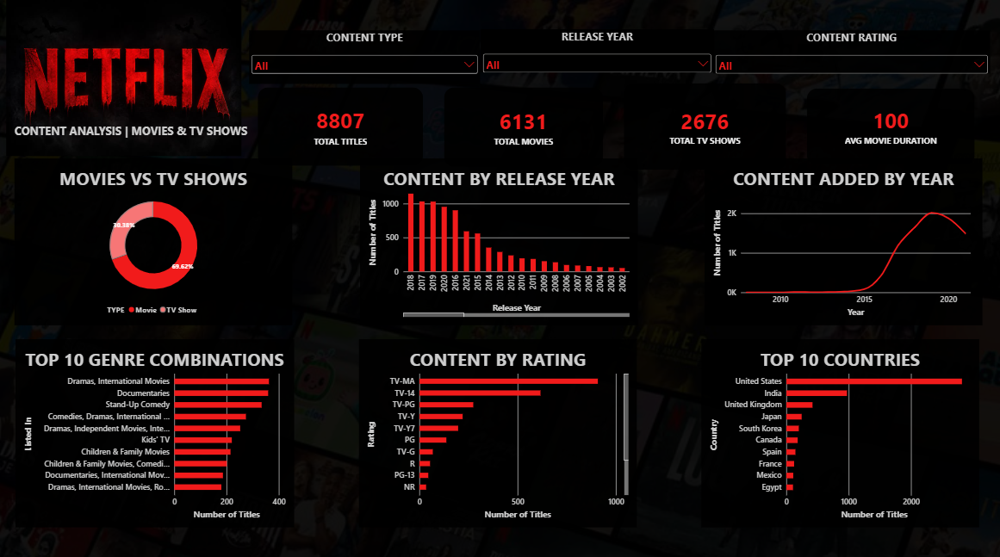

# Netflix Content Analysis Dashboard

An interactive Power BI dashboard analyzing 8,807 Netflix titles.

## What it shows
- Movies vs TV Shows
- Content by release year and year added
- Top 10 genre combinations
- Content by rating
- Top 10 countries

## Filters
Content type, release year, content rating

## Tools used
Power BI

## Dataset
Netflix Movies and TV Shows (Kaggle)

## What I learned
I learned how to clean data, create slicers, and build different charts in Power BI.
